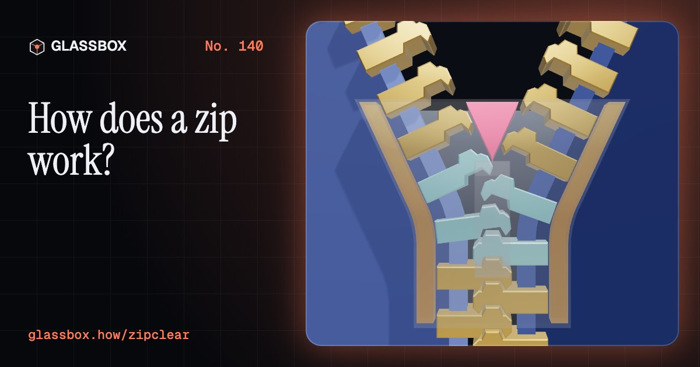
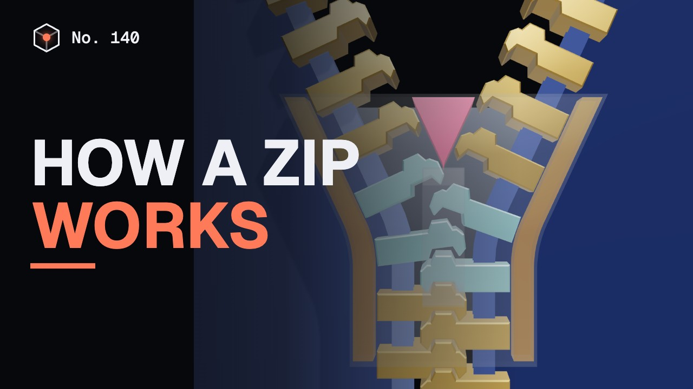
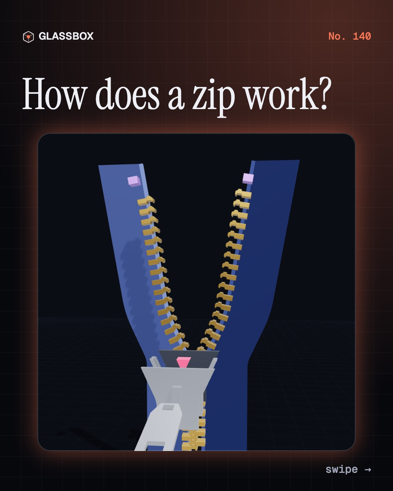
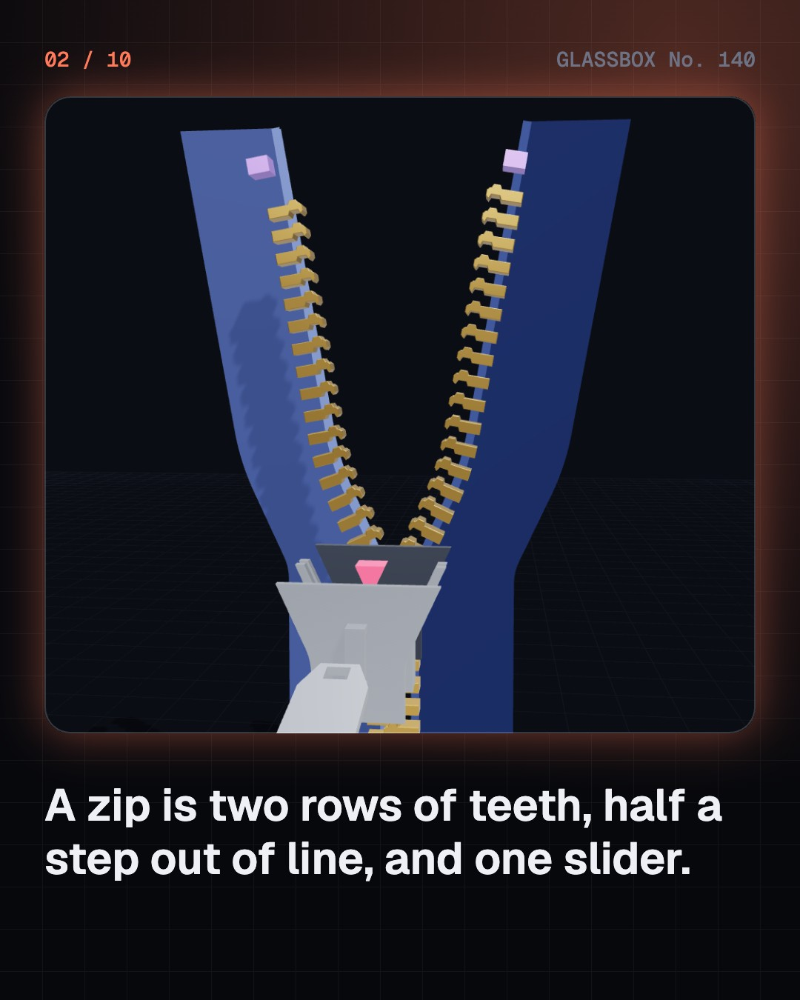
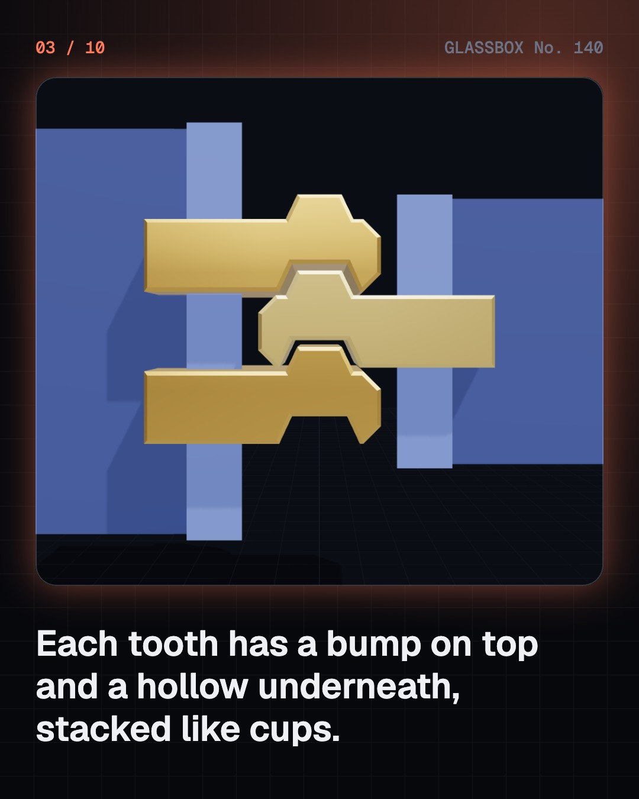
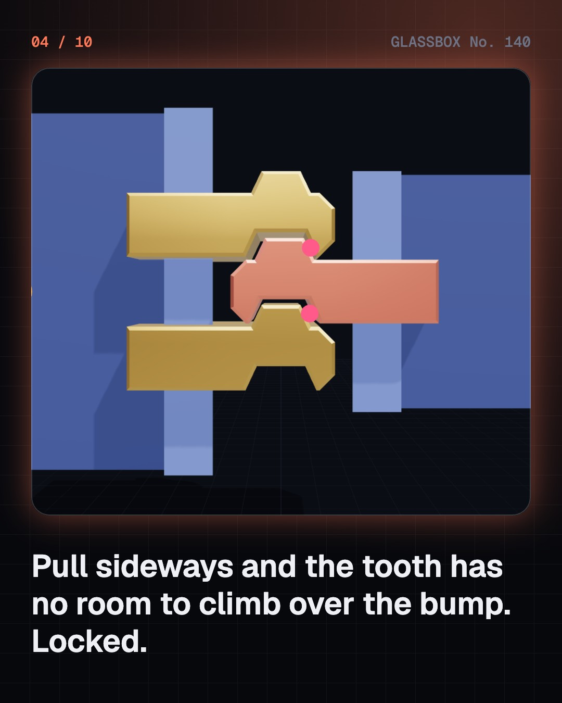

<!-- glassbox:start -->
<!-- Generated from glassbox.json by the Glassbox hub (npm run readme -- zipclear). Edit glassbox.json, not this block. -->
<p align="center"><a href="https://glassbox.how/e/zipclear/"></a></p>

<h1 align="center">ZipClear</h1>

<p align="center"><b>How does a zip work?</b><br>Two rows of tiny teeth, each with a bump on top and a hollow underneath, and one slider with a wedge inside. See in slow motion how a zip locks tooth by tooth, why you cannot pull it apart sideways, and why a worn slider makes it split.</p>

<p align="center"><a href="https://glassbox.how/zipclear/"><b>▶ Play with it</b></a> &nbsp;·&nbsp; <a href="https://glassbox.how/e/zipclear/">Read the 60-second explainer</a> &nbsp;·&nbsp; <a href="https://glassbox.how/zipclear/glassbox/reel.mp4">Watch the 40-second video</a></p>

<p align="center">
  <a href="https://glassbox.how/e/zipclear/"></a>
  <a href="https://glassbox.how/e/zipclear/"></a>
  <a href="LICENSE"></a>
  <a href="LICENSE-CONTENT.md"></a>
  <a href="#privacy"></a>
</p>

## In 60 seconds

1. **Two tapes, two rows of teeth, one slider.** A zip is two cloth tapes, each with a row of small teeth clamped along a corded edge. The rows are offset by half a pitch, so every tooth faces a gap. A slider rides on both rows, and stops at the ends keep it on.
2. **A bump on top, a hollow underneath.** Each tooth head has a small bump on top and a matching hollow below. In a closed zip the heads are stacked like cups. To slide out sideways a tooth would have to climb over one bump and let go of another, and it has only a few hundredths of a millimetre of play.
3. **The slider bends the tape.** Inside the slider is a Y-shaped channel. It bends each tape with the teeth on the outside of the curve, so the heads fan apart for a moment. As the rows converge, each head tips into the open gap across the way, one tooth at a time. Then the channel runs straight and the gaps close.
4. **A wedge, working on one tooth at a time.** Going down, the diamond in the fork of the Y is a wedge driven between the rows. A pull along the zip becomes a push sideways: pull ÷ (2 × tan(φ + λ)). The closed chain can hold hundreds of newtons sideways, but the slider needs only a few, because it frees a single tooth at a time.
5. **Why a zip splits behind the slider.** A slider is cast from soft zinc alloy. When its channel spreads by a few tenths of a millimetre, it no longer presses each bump fully into its hollow, and a tug rides the teeth apart. Squeezing the slider gently with pliers closes the channel again.
6. **Metal, moulded plastic and coil.** Metal teeth are stamped and clamped on. Plastic teeth are moulded on to the tape. A coil zip is one long nylon spiral whose loops act as teeth, and it is the commonest of all. The size number, such as #5, is roughly the width of the closed chain in millimetres.

## Words worth knowing

| Term | Meaning |
|---|---|
| **Tooth (element)** | One of the small shaped pieces along the edge of a zip tape. Two rows of them lock together. |
| **Pitch** | The distance from one tooth to the next on the same tape. The two rows are offset by half a pitch. |
| **Slider** | The moving part of a zip. Its Y-shaped channel meshes the teeth going one way and parts them going the other. |
| **Diamond** | The wedge inside the top of the slider that drives between the two rows to open the zip. |
| **Play** | Spare room for a part to move. Locked zip teeth have almost none, which is why they cannot climb over each other. |
| **Wedge** | A simple machine: a slope that turns a push in one direction into a push at right angles to it. |
| **Crosswise strength** | The sideways pull a closed zip can take before it fails, tested on 25 mm of chain. |
| **Coil zip** | A zip whose teeth are the loops of one long plastic spiral sewn to the tape. |
| **Auto-lock slider** | A slider with a sprung pin that drops between two teeth when you let go of the pull tab, so the zip stays put. |

## A short history

**175 years from a forgotten patent for sliding clasps to the billions of zips made every year.**

- **1851** · A patent that went nowhere (Elias Howe Jr., Massachusetts, USA)
- **1893** · The clasp locker (Whitcomb L. Judson, Chicago, USA)
- **1913** · Hookless No. 2: the modern zip (Gideon Sundback, Hoboken, New Jersey, and Meadville, Pennsylvania, USA)
- **1917** · The ‘Separable Fastener’ patent (Gideon Sundback, Meadville, Pennsylvania, USA)
- **1923** · Rubber boots give it a name (B.F. Goodrich Company and Bertram G. Work, Akron, Ohio, USA)
- **1934** · A small zip shop in Tokyo (Tadao Yoshida, Higashi Nihonbashi, Tokyo, Japan)
- **1937** · The Battle of the Fly (Esquire magazine, tailors and the Hookless Fastener Company, USA, France and Britain)
- **1940** · Teeth made from a plastic coil (Alden W. Hanson; Opti-Werk, J. R. Ruhrmann and Prym, USA and West Germany)

The full story, with 29 moments, charts, people and 41 sources: [glassbox.how/e/zipclear/history](https://glassbox.how/e/zipclear/history/). The data lives in [`history.json`](history.json).

## Video and slides

Made with the Glassbox studio from this box's storyboard (`window.glassbox.director`). Free to reuse under CC BY 4.0.

<a href="https://glassbox.how/zipclear/glassbox/video.mp4"></a>

<p><a href="glassbox/slide-1.jpg"></a> <a href="glassbox/slide-2.jpg"></a> <a href="glassbox/slide-3.jpg"></a> <a href="glassbox/slide-4.jpg"></a></p>

| File | What | Size |
|---|---|---|
| [`glassbox/reel.mp4`](https://glassbox.how/zipclear/glassbox/reel.mp4) | Reel / Short, with captions and soundtrack | 1080×1920 |
| [`glassbox/video.mp4`](https://glassbox.how/zipclear/glassbox/video.mp4) | YouTube video, with captions and soundtrack | 1920×1080 |
| `glassbox/slide-1…10.jpg` | Instagram carousel | 1080×1350 |
| `glassbox/thumb.jpg` | YouTube thumbnail | 1280×720 |
| `glassbox/cover.jpg` | Share card and repo social preview | 1200×630 |
| [`glassbox/history-reel.mp4`](https://glassbox.how/zipclear/glassbox/history-reel.mp4) | “History in 10 moments” Reel / Short | 1080×1920 |
| `glassbox/history-slide-*.jpg` | History carousel | 1080×1350 |
| `glassbox/post.json` | Post copy and schedule used by the publish kit | |

## Privacy

This box has no accounts and no ads, and it ships its own fonts and libraries. When you run it yourself it sends nothing anywhere. On glassbox.how, the site's `/bar.js` also loads Glassbox's analytics: **Google Analytics** to count visits (it asks first in the EU, UK and Switzerland, and stays off when your browser sends Global Privacy Control or Do Not Track) and **ClickTrust** to detect bots.

It remembers a few things **in your own browser only**, and never sends them anywhere:

| Browser storage key | What it holds |
|---|---|
| `zipclear.v1` | Which chapters you have opened, your best quiz scores, and sound on or off. |

Exactly what each one sees is at [glassbox.how/privacy](https://glassbox.how/privacy/).

## Licences

- **Code:** [MIT](LICENSE). Use it, change it, ship it.
- **Explanations, text, images and videos** (`glassbox.json`, `glassbox/`): [CC BY 4.0](LICENSE-CONTENT.md). Credit “Glassbox, glassbox.how/e/zipclear”.
- **Third-party parts** keep their own licences: [three.js](https://threejs.org) (MIT), [Geist, Instrument Serif](https://openfontlicense.org) (SIL OFL 1.1).
- The Glassbox name and logo aren't covered by either licence. See the [terms](https://glassbox.how/terms/).

Found a mistake? [Open an issue](https://github.com/bdeeps/zipclear/issues). Corrections happen in public.
<!-- glassbox:end -->

## Run it

It's plain HTML, CSS and JavaScript. No build step and no dependencies. Run locally, it contacts no other website.

```bash
python3 -m http.server 8000
```

Three.js and the fonts ship in `vendor/` and `fonts/`, so it also works offline.

Then open http://localhost:8000.

## How it's built

| File | What |
|---|---|
| `index.html`, `css/app.css` | The page and its styles |
| `js/app.js`, `js/stage.js`, `js/ui.js`, `js/kit.js` | The shared Glassbox 3D engine: chapters, 3D stage, controls, quiz, video director |
| `js/chapters/*.js` | One file per chapter: the 3D model, controls, text, key terms, quiz and video scenes |
| `js/zipmath.js` | ZipClear's numbers with no 3D in them: tooth outlines, the path each tape takes through the slider, the play between teeth, the wedge forces and the worn-slider model |
| `js/zip.js` | ZipClear's 3D parts: a whole zip whose slider is cut to fit the teeth's motion, single teeth, coil loops, chart boards and force arrows |
| `glassbox.json` | Title, question, explainer beats, key terms, browser storage and credits shown on glassbox.how |
| `reel` in each chapter | The storyboard the Glassbox studio records into short videos |
| `glassbox/` | The published video, slides, thumbnail and post copy |
| `fonts/`, `vendor/three/` | Self-hosted Geist and Instrument Serif (SIL OFL 1.1) and three.js (MIT) |
